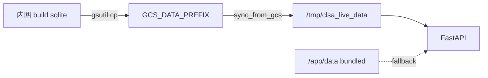

# 网页数据热更新（不重建 Cloud Run 镜像）

## 原则

- **每日只热更新数据**，不跑 `./deploy.sh` 全量构建。
- 内网机器：拉 CMDS/Wind → 建 sqlite → **上传 GCS**。
- Cloud Run：启动时 / 定时轮询 / 管理接口从 GCS 拉到 `/tmp/clsa_live_data`，**优先于镜像内 `/app/data`**。



## Cloud Run 环境变量（一次性配置）

| 变量 | 含义 |
|------|------|
| `GCS_DATA_PREFIX` | 如 `gs://YOUR_BUCKET/clsa-eqd-data` |
| `DATA_RELOAD_TOKEN` | 管理接口密钥（强随机串） |
| `DATA_POLL_SECONDS` | 轮询间隔，默认 `300`；`0` 关闭 |
| `LIVE_DATA_DIR` | 默认 `/tmp/clsa_live_data` |

Service account 需对该 GCS 前缀有 `storage.objects.get`（通常 `roles/storage.objectViewer`）。

一次性创建 bucket 前缀并绑定（示例）：

```bash
gsutil mb -l us-west1 gs://YOUR_BUCKET   # 若尚无
# Cloud Run 控制台 → 服务 → 编辑 → Variables & Secrets / 服务账号权限
```

代码侧需 **再 deploy 一次** 才能带上热更新逻辑与 `google-cloud-storage`；之后日常 **只** 跑热更新脚本。

## 每日命令（内网）

```bash
export GCS_DATA_PREFIX=gs://YOUR_BUCKET/clsa-eqd-data
export DATA_RELOAD_TOKEN='…'
# 完整：拉数+建库+上传+触发
bash scripts/hot_update_data.sh

# 已有 sqlite，只上传
SKIP_BUILD=1 bash scripts/hot_update_data.sh
```

管理接口：

```bash
curl -sS -X POST "$SERVICE_URL/api/admin/reload-data?force=true" \
  -H "X-Data-Reload-Token: $DATA_RELOAD_TOKEN"

curl -sS -H "X-Data-Reload-Token: $DATA_RELOAD_TOKEN" \
  "$SERVICE_URL/api/admin/data-status"
```

多实例：一次 POST 只打到一台；其余实例靠 `DATA_POLL_SECONDS` 或冷启动同步。

## 热文件清单

`cffex_vol.sqlite`（必须）、`commodity_fut.sqlite`、`qis_results.sqlite`、`rates_eod.parquet`、`index_spot.parquet`、`vol_spread_levels.parquet`、`synth_tenors_cache.json.gz`。

## 相关代码

- [backend/data_paths.py](../backend/data_paths.py)
- [backend/data_hot_reload.py](../backend/data_hot_reload.py)
- [backend/api/v1/admin_data.py](../backend/api/v1/admin_data.py)
- [scripts/hot_update_data.sh](../../scripts/hot_update_data.sh)
